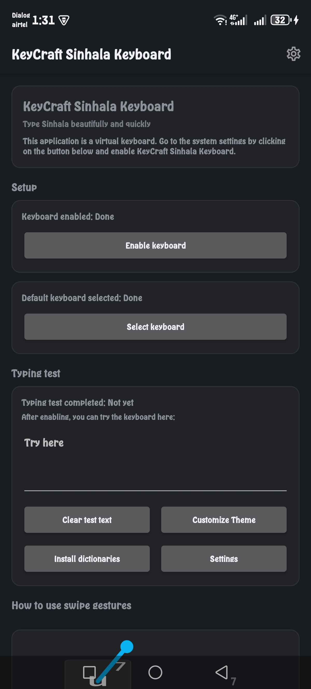

# KeyCraft Sinhala Keyboard

KeyCraft is an open-source Sinhala keyboard for Android. It supports Sinhala typing with transliteration, configurable keyboard layouts, dictionary-based suggestions, themes, haptic feedback, and optional dictionary downloads.

## Features

- **Sinhala keyboard:** Type Sinhala using the app's Sinhala input support.
- **Keyboard layouts:** Choose and customize available layouts.
- **Dictionary support:** Use dictionary-backed word suggestions.
- **Themes:** Customize the keyboard's appearance.
- **Haptic feedback:** Enable or adjust vibration feedback while typing.
- **Optional dictionary downloads:** Download additional dictionaries when wanted.

## Typing Sinhala

Select the Sinhala layout in Settings for direct letter input. Shift selects vowel signs and additional letters. Use the number key for digits and symbols. On the Sinhala layout, **EN** switches to Latin keys and **සි** restores the Sinhala layer. On a Latin layout, the **සි / EN** key switches Singlish suggestions on or off and remembers the choice. By default Latin spelling stays in the editor until you tap a candidate. Space keeps the literal spelling, including English and abbreviations. Turn off **Keep Singlish until a suggestion is selected** to use the older live Sinhala preview and space-to-commit behavior.

Enter consonants before dependent vowels, including visually leading signs such as ෙ. For example ක followed by ෙ produces කෙ. A second vowel sign replaces the first. Type a virama followed by another consonant for ක්ක or ත්ත. The layout offers explicit joiner keys for joined forms. Backspace removes a final sign first, then unwinds the last consonant of a cluster and its connector. Clipboard paste inserts the original text.

The candidate strip initially shows up to three words. Expand it to see more suggestions. When you move the cursor within Sinhala text or press Backspace, suggestions follow the complete Sinhala clusters before the cursor. For example, `niwaradhi` suggests නිවරදි, and `aayuboovan` suggests ආයුබෝවන්. Spellings can be ambiguous. The bundled Sinhala dictionary at `assets/dict/si.dict` is a compiled Cdict trie. Its generator combines Sinhala words with integer frequency weights. The next-word engine uses one- and two-word contexts and locally learned transitions.

**Personal Sinhala dictionary** in Settings lists saved words. Tap **Add word** to save one or tap an entry to remove it. The keyboard counts accepted Sinhala words and direct entries completed with Space, up to 256 words. The app stores these counts locally, outside Android backup. Sensitive fields skip learning. Swipe gestures and double-space punctuation have separate switches. Double-space punctuation is off by default.

## සිංහල වචන එක් කිරීම

නව වචනයක් එක් කිරීමට [si_reviewed.tsv](srcs/dictionaries/si_reviewed.tsv) වෙත
UTF-8 TSV පේළියක් යොදන්න. තීරු පිළිවෙළට වචනය, ප්‍රමුඛතාව, Singlish aliases,
මූලාශ්‍රය, බලපත්‍රය, human review reference එක සහ review status එක සටහන් කරන්න. වචනයේ spelling
සහ මූලාශ්‍රයේ බෙදාහැරීමේ අවසරය review එකේදී තහවුරු කරන්න.

- `word` තීරුවට එක් සිංහල වචනයක් යොදන්න. Generator එක NFC වලට normalize කර
  සමාන වචන, වැරදි අක්ෂර සහ අසම්පූර්ණ පිල්ලම් හෝ joiner අනුක්‍රම ප්‍රතික්ෂේප කරයි.
- `priority` හිස් තැබුවොත් 12 යොදාගනී. පරාසය 1–15 වේ.
  `singlish_aliases` හිස් හෝ comma වලින් වෙන් කළ lowercase ASCII aliases වේ.
  එක් alias එකකට එක් සිංහල වචනයක් යොදන්න.
- `source` සහ `review` සඳහා `https://` හෝ `repo:` යොමුවක් ද,
  `license` සඳහා SPDX identifier එකක් ද යොදන්න.
- `status` සඳහා `PENDING`, `APPROVED` හෝ `REJECTED` යොදන්න.
  Draft entries review queue එකේ තබන්න. Batch එකක් අනුමත කළ පසු, එහි rows
  `si_reviewed.tsv` වෙත ගෙන ගොස් source, license සහ reviewer reference සමඟ
  `APPROVED` යොදන්න. Dictionary එකට සහ alias asset එකට එක් වන්නේ එම rows පමණි.
- `python3 gen_sinhala_dict.py` මගින් offline assets නැවත සාදා
  `python3 gen_sinhala_dict.py --check`, `python3 scripts/run_sinhala_python_tests.py`
  සහ `./gradlew testDebugUnitTest` ධාවනය කරන්න. TSV වෙනස සහ generated assets
  එකම review එකට ඉදිරිපත් කරන්න.

Direct Sinhala යෝජනාවල exact match එක මුලින් ලැබේ. සුරැකි වචනවල frequency සමාන
විට app process එක තුළ වඩා මෑතදී භාවිත කළ වචනය ඉදිරියට එයි. Singlish literal mode
එකේ Latin spelling එක පෙනෙන අතර, reviewed alias ලැබුණොත් Sinhala candidate එකක්
ලෙස තෝරාගත හැක. [ශබ්දකෝෂ මූලාශ්‍ර සහ බලපත්‍ර](srcs/dictionaries/README.md).

Suggestion quality සඳහා [වාක්‍ය 100ක Top‑3 benchmark එක](docs/SINHALA_TOP3_BENCHMARK.md) බලන්න.

## Repository structure

| Path | Contents |
| --- | --- |
| `srcs/java/` | Android keyboard implementation, including Sinhala input and suggestions |
| `srcs/layouts/`, `res/` | Keyboard layout definitions and Android resources |
| `assets/` | Bundled dictionaries and font assets |
| `test/`, `src/androidTest/` | JVM unit tests and Android instrumentation tests |
| `scripts/` | Sinhala test runner and release APK smoke-test tooling |
| `buildSrc/`, `gradle/` | Gradle build logic and wrapper |
| `vendor/cdict` | Dictionary library submodule |
| `docs/` | Documentation, release notes, and landing page |
| `fastlane/metadata/android/` | App listing metadata and screenshots |

## Requirements

To build the Android app, install:

- **JDK 17**
- **Android SDK** with Platform 36 and Build Tools 36.0.0, as used by CI
- **Python 3** for Gradle’s layout checks, resource generation, and Python tests

[Android Studio](https://developer.android.com/studio) can install and manage the required JDK and Android SDK components. If Gradle cannot locate your SDK, configure the SDK location in Android Studio or set `ANDROID_HOME` / `ANDROID_SDK_ROOT`.

## Build

Clone the repository:

```sh
git clone --recurse-submodules https://github.com/Lakmal2078/KeyCraft-Sinhala-Keyboard.git
cd KeyCraft-Sinhala-Keyboard
```

If you already cloned the repository without its submodules, run `git submodule update --init --recursive` from the checkout.

Build the debug APK with the included Gradle wrapper:

```sh
./gradlew assembleDebug
```

The APK is written to:

```text
build/outputs/apk/debug/KeyCraft-Sinhala-Keyboard-debug.apk
```

## Tests and limitations

Run `./gradlew testDebugUnitTest` for JVM tests, `python3 scripts/run_sinhala_python_tests.py` for layout and dictionary generation tests, and `./gradlew connectedDebugAndroidTest` with an Android device for instrumentation tests. App-specific editing depends on the host exposing selection and surrounding text through Android’s input connection. Private fields and editors that omit surrounding text can limit contextual editing. Gesture-only alternatives require swipes to be enabled. Offline predictions depend on the bundled vocabulary and local history.

## Install

Version 1.4.3 requires Android 10 (API 29) or later.

1. Download the latest APK from the [GitHub Releases](https://github.com/Lakmal2078/KeyCraft-Sinhala-Keyboard/releases) page, or build it using the instructions above.
2. Open the APK on your Android device and approve installation from that source if Android asks.
3. Open KeyCraft and follow the in-app instructions to enable it as an input method and select it as the current keyboard.

The exact Settings labels can vary by Android version and device manufacturer.

## Privacy and backups

KeyCraft disables Android cloud backup and configures Android to exclude its app data from cloud backup and device-to-device transfer. This includes keyboard settings, learned words, downloaded dictionaries, and pinned clipboard entries. The in-memory clipboard history is not persisted.

## Screenshots

The following screenshots are stored in this repository:

| Keyboard | Settings | Themes |
| --- | --- | --- |
|  |  |  |

## Contributing

Bug reports, suggestions, and code contributions are welcome. Please read the [Contributing Guide](CONTRIBUTING.md) before submitting changes.

## License

KeyCraft is distributed under the [GNU General Public License v3.0](LICENSE). See [Third-party notices](docs/THIRD_PARTY_NOTICES.md) for notices and licensing information for bundled third-party components.
