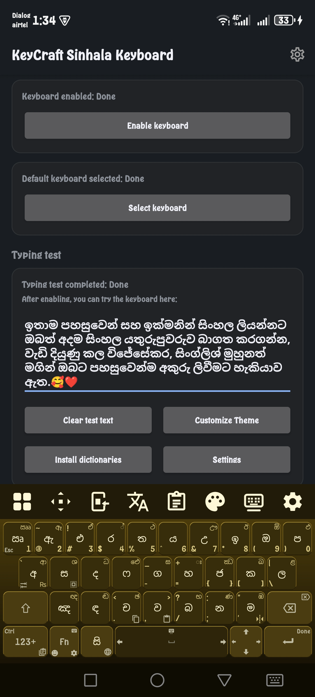
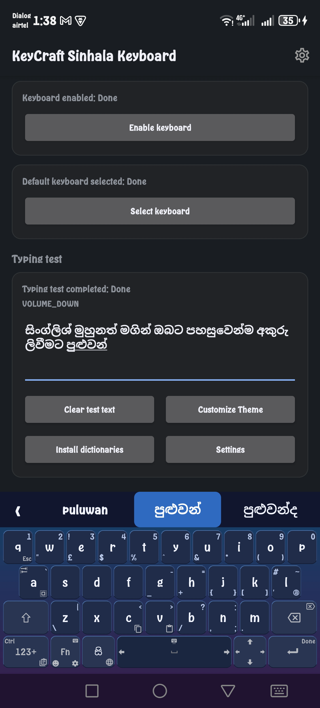

# KeyCraft Sinhala Keyboard

KeyCraft is a free, open-source Sinhala keyboard for Android. Type in Singlish and convert it to Sinhala with on-device transliteration, swipe typing, customizable layouts and themes. Built for fast, flexible everyday Sinhala typing without ads.

**සිංහල ලිවීම ලස්සනට, ඉක්මනට**

*Type Sinhala beautifully and quickly.*

KeyCraft යනු සිංහල සහ දෛනික ටයිප් කිරීම පහසු කරවන, Android සඳහා නිර්මාණය කළ අභිරුචිකරණය කළ හැකි Keyboard යෙදුමකි. Singlish → Sinhala පරිවර්තනය, Swipe Typing, විවිධ Keyboard Layouts, Themes සහ Productivity Tools එකම යෙදුමකින් ලබා දෙයි.

[**⬇️ KeyCraft v1.1.1 Download කරන්න**](https://github.com/Lakmal2078/KeyCraft-Sinhala-Keyboard/releases/tag/v1.1.1) · [Source Code](https://github.com/Lakmal2078/KeyCraft-Sinhala-Keyboard) · [Bug එකක් වාර්තා කරන්න](https://github.com/Lakmal2078/KeyCraft-Sinhala-Keyboard/issues)

---

## 📥 Download සහ Install කිරීම

1. [KeyCraft v1.1.1 Release පිටුවට](https://github.com/Lakmal2078/KeyCraft-Sinhala-Keyboard/releases/tag/v1.1.1) යන්න.
2. **KeyCraft-Sinhala-Keyboard-release.apk** ගොනුව Download කරන්න.
3. Download කළ APK එක විවෘත කර Android ඉල්ලන්නේ නම් එම Source එකෙන් Install කිරීමට අවසර දෙන්න.
4. KeyCraft විවෘත කර තිරයේ පෙන්වන පියවර අනුගමනය කර Keyboard එක Enable කර Default Keyboard ලෙස තෝරන්න.

> **සටහන:** Android Version එක සහ දුරකථන නිෂ්පාදකයා අනුව Settings මෙනුවේ නම් වෙනස් විය හැක. නිල Release පිටුවෙන් පමණක් APK Download කරන්න.

## ✨ ප්‍රධාන විශේෂාංග

- **Sinhala Auto-Transliteration** — Singlish ලෙස ටයිප් කර සිංහලට ස්වයංක්‍රීයව පරිවර්තනය කරන්න. උදාහරණයක් ලෙස \`amma\` → \`අම්මා\`.
- **Word Suggestions** — වචන සම්පූර්ණ කිරීම සහ අක්ෂර වින්‍යාස යෝජනා.
- **Swipe Typing** — යතුරක කොන් දෙසට Swipe කිරීමෙන් අමතර අක්ෂර ඇතුළත් කරන්න.
- **Customizable Layouts** — Keyboard Layouts තෝරන්න, අමතර Layouts සහ Keys එක් කරන්න.
- **Themes සහ පෙනුම** — වර්ණ, Key Shapes, Borders, Fonts, Spacing සහ Keyboard ප්‍රමාණය වෙනස් කරන්න.
- **Productivity Tools** — Quick Calculator, Text Shortcuts සහ Quick-Action Toolbar.
- **Clipboard Tools** — අවශ්‍ය පරිදි Clipboard History සහ Quick Paste භාවිත කරන්න.
- **Typing Controls** — Number Row, NumPad, Key Repeat, Auto Capitalization, Vibration ඇතුළු තවත් සැකසුම්.

## 📱 Screenshots

| Keyboard | Settings | Themes |
| --- | --- | --- |
|  |  |  |

## 🔐 පෞද්ගලිකත්වය (Privacy)

- Sinhala Transliteration ක්‍රියාවලිය උපාංගය තුළම සිදු වේ.
- Optional Dictionaries Download කිරීමට Internet Permission භාවිත වේ.
- Clipboard පහසුකම් සැකසුම් මඟින් පාලනය කළ හැක. Clipboard History හෝ Preview සක්‍රිය කිරීමට පෙර ඒවායේ Settings පරීක්ෂා කරන්න.
- KeyCraft තුළ දැන්වීම් (Ads) නොමැත.
- Keyboard preferences සහ app data cloud backup හෝ device-to-device transfer වෙත backup නොවේ.

KeyCraft විවෘත මූලාශ්‍ර (Open Source) ව්‍යාපෘතියකි. Source Code එක පරීක්ෂා කර යෙදුමේ Permissions සහ ක්‍රියාකාරීත්වය පිළිබඳව වැඩිදුර සොයා බැලිය හැක.

## 🛠️ Source Code එකෙන් Build කිරීම

### අවශ්‍යතා (Requirements)

- JDK 17
- Android SDK — Android Platform 36 සහ ඊට ගැළපෙන Build Tools
- Python 3
- FontForge
- Git සහ Submodule Support

Repository එක සහ Submodules Clone කරන්න:

~~~sh
git clone --recurse-submodules https://github.com/Lakmal2078/KeyCraft-Sinhala-Keyboard.git
cd KeyCraft-Sinhala-Keyboard
~~~

දැනටමත් Clone කර ඇති Repository එකක Submodules ලබාගැනීමට:

~~~sh
git submodule update --init --recursive
~~~

Dictionary reader එක pure Java බැවින් Android NDK අවශ්‍ය නොවේ. සම්පූර්ණ Development Environment උපදෙස් සඳහා [CONTRIBUTING.md](CONTRIBUTING.md) බලන්න.

### Tests ධාවනය කිරීම

Sinhala Python generator tests සඳහා නිවැරදි discovery path එක:

~~~sh
python3 scripts/run_sinhala_python_tests.py
~~~

Android JVM unit tests සහ lint:

~~~sh
./gradlew test
./gradlew lintDebug
~~~

### Debug APK එක Build කිරීම

~~~sh
./gradlew assembleDebug
~~~

APK Output Path එක:

~~~text
build/outputs/apk/debug/KeyCraft-Sinhala-Keyboard-debug.apk
~~~

### Signed Release APK එක Local Build කිරීම

Release APK එක Sign කිරීම සඳහා ඔබ සතු Release Keystore එකක් භාවිත කළ යුතුය. Keystore ගොනු හෝ Signing Passwords කිසිවිටෙක Git Repository එකට Commit නොකරන්න.

1. Environment Template එක Copy කරන්න:
   ~~~sh
   cp .env.example .env
   chmod 600 .env
   ~~~
2. \`.env\` ගොනුව තුළ පහත Values සකසන්න:
   - \`RELEASE_KEYSTORE\`
   - \`RELEASE_KEYSTORE_PASSWORD\`
   - \`RELEASE_KEY_ALIAS\`
   - \`RELEASE_KEY_PASSWORD\`
3. Release Build එක ධාවනය කරන්න:
   ~~~sh
   bash ./build_release.sh
   ~~~

APK Output Path එක:

~~~text
build/outputs/apk/release/KeyCraft-Sinhala-Keyboard-release.apk
~~~

### GitHub Actions මඟින් Release කිරීම

\`v*\` ආකෘතියේ Git Tag එකක් Push කළ විට **Build and release signed APK** GitHub Actions Workflow එක Tests ධාවනය කර Signed Release APK එක Build කරයි. ඉන්පසු APK එක සහ එහි SHA-256 Checksum එක GitHub Releases වෙත Publish කරයි.

Release පවත්වාගෙන යන Maintainers විසින් Repository Settings → Secrets and variables → Actions යටතේ පහත Secrets සකසා තිබිය යුතුය:

- \`RELEASE_KEYSTORE_BASE64\`
- \`RELEASE_KEYSTORE_PASSWORD\`
- \`RELEASE_KEY_ALIAS\`
- \`RELEASE_KEY_PASSWORD\`

Secret Values Source Files, Git Commits හෝ Workflow Logs තුළ ඇතුළත් නොකරන්න.

## 🤝 දායකත්වය (Contributing)

නව අදහස්, Bug Reports සහ Code Contributions සාදරයෙන් පිළිගනිමු. වෙනස්කම් ඉදිරිපත් කිරීමට පෙර [CONTRIBUTING.md](CONTRIBUTING.md) කියවන්න.

Bug එකක් වාර්තා කරන විට Android Version එක, Device තොරතුරු සහ ගැටලුව නැවත ඇතිකරන පියවර සඳහන් කරන්න. පෞද්ගලික පණිවිඩ හෝ සංවේදී Clipboard දත්ත Bug Reports තුළ ඇතුළත් නොකරන්න.

## 📄 බලපත්‍රය (License)

KeyCraft **GNU General Public License v3.0 (GPL-3.0)** යටතේ බෙදාහරිනු ලැබේ. සම්පූර්ණ බලපත්‍ර කොන්දේසි සඳහා [LICENSE](LICENSE) ගොනුව බලන්න. Bundled third-party assets සහ ඒවායේ බලපත්‍ර සඳහා [Third-party notices](docs/THIRD_PARTY_NOTICES.md) බලන්න.

## 🙏 ස්තුතිය සහ පිළිගැනීම් (Credits)

KeyCraft, Julow සහ දායකයන් විසින් සංවර්ධනය කළ [Unexpected Keyboard](https://github.com/Julow/Unexpected-Keyboard) ව්‍යාපෘතිය මත පදනම් වේ. අදාළ Upstream Copyright Notices සහ License කොන්දේසි එලෙසම පවත්වාගෙන යයි. මුල් සංවර්ධකයන්ට සහ මෙම ව්‍යාපෘතියට දායක වූ සියලු දෙනාට ස්තුතියි.
